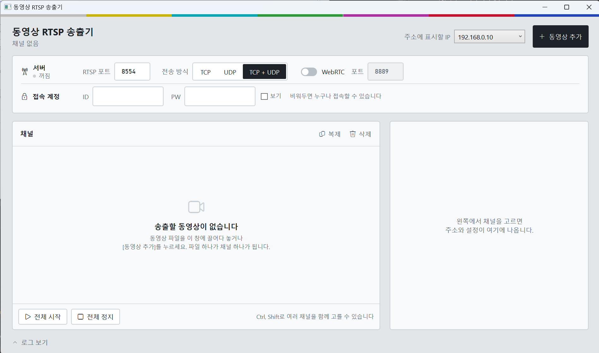

# 동영상 RTSP · WebRTC 송출기

동영상 파일이나 다른 RTSP 스트림을 **RTSP 와 WebRTC 로 동시에 송출**하는 Windows 데스크톱 앱(WPF, .NET Framework 4.7.2).
플레이어(VLC 등)는 RTSP 로, 브라우저는 WebRTC 로 — 한 번의 송출로 둘 다 볼 수 있습니다.
채널마다 경로를 나눠(`rtsp://IP:포트/채널이름`) 여러 개를 동시에 송출할 수 있습니다.



## 주요 기능

- **입력 소스**: 로컬 동영상 파일 또는 다른 RTSP 주소(리레이/재송출)
- **코덱 변환**: 원본 그대로(copy) / H.264 / H.265 / MPEG-4
- **시청 방식**: RTSP(VLC 등 플레이어) + WebRTC(브라우저)
- **채널별 경로**와 공통 **ID/PW 인증**
- 파일 반복 재생, 채널 복제 등

## 다운로드 (바로 실행)

[**Releases**](../../releases) 에서 최신 zip 을 받아 압축을 풀고 `rtsp-webrtc-streamer.exe` 를 실행하세요.
ffmpeg·mediamtx 가 함께 들어 있어 따로 받을 필요가 없습니다.

## 구조

```
동영상 파일 / RTSP ──[ffmpeg]──▶ mediamtx ──▶ 시청자 (VLC, 브라우저…)
                     (읽어서 publish)   (RTSP·WebRTC 서버)
```

- **ffmpeg**: 입력을 읽어 실시간으로 서버에 밀어넣기(+코덱 변환)
- **mediamtx**: 받은 스트림을 여러 시청자에게 RTSP·WebRTC 로 배포

두 프로그램은 `tools\` 폴더에 포함되어 있습니다(Git LFS).

## 소스에서 빌드

- Visual Studio 2022+ 에서 `rtsp-webrtc-streamer.slnx` 열기 → 빌드/실행 (F5)
- 또는 MSBuild: `MSBuild rtsp-webrtc-streamer.csproj /p:Configuration=Release`
- 실행 후 채널을 추가하고 파일 또는 RTSP 주소를 지정 → **송출 시작**

## 사용 메모

- **브라우저(WebRTC)로 볼 때는 코덱을 H.264 로** 하세요. H.265·MPEG-4 는 RTSP 전용입니다.
- 다른 PC에서 접속하려면 상단 "주소에 표시할 IP"를 이 PC의 LAN IP로 바꾸고, 방화벽에서 RTSP/WebRTC 포트를 열어 주세요.

## 라이선스

이 프로젝트의 소스 코드는 **BSD 3-Clause License** 를 따릅니다. 자세한 내용은 [LICENSE](LICENSE) 참고.
함께 배포되는 ffmpeg·mediamtx 는 각자의 라이선스(ffmpeg: GPL/LGPL, mediamtx: MIT)를 따릅니다.
